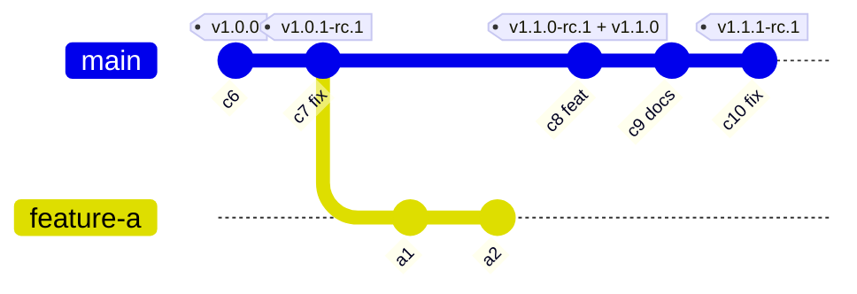
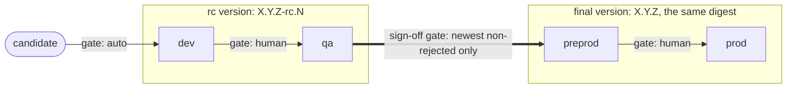
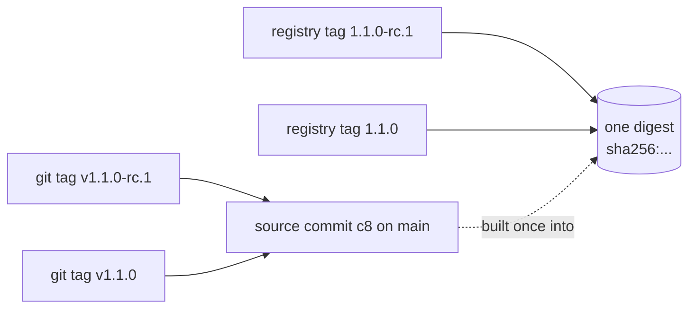
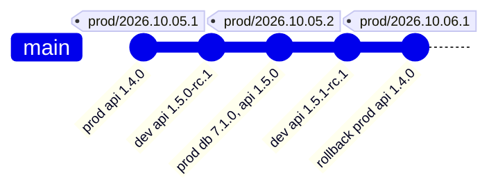
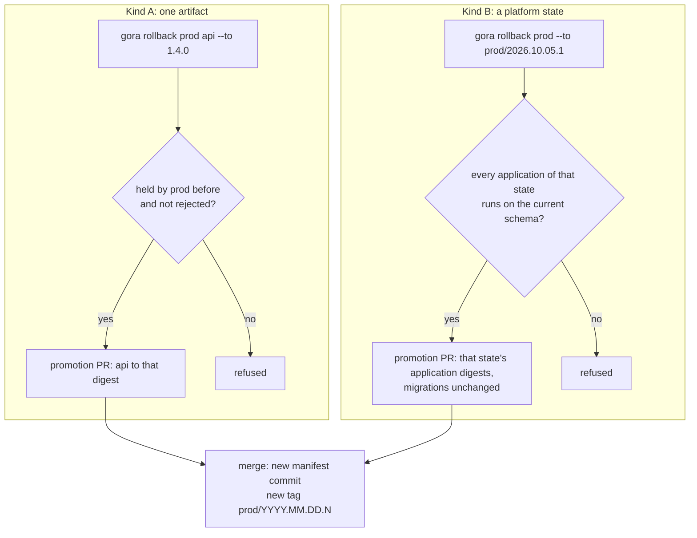
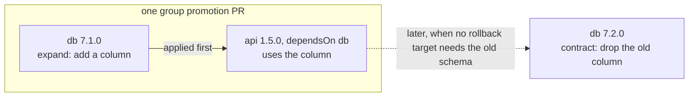

# Release model

This is the map of how an artifact travels from a merge on `main` to production, and of the
laws that hold on the way. The decisions behind it are Architecture Decision Records:
[ADR-022](../adr/0022-lifecycle-on-trunk.md) decides this model and amends the ADRs it
changes. If this map and an ADR disagree, the ADR is right and the map has a defect.

**The rule for every change.** A change, a recommendation or a plan that contradicts a law
below stops there: it is raised with the maintainer, never worked around and never
reinterpreted. A law changes only through an ADR.

## 1. Vocabulary

GORA's verb is **promote**. In this model an artifact is promoted or it stays where it is;
"release" is not an event and not a verb. The word survives only in names already fixed: the
product, the files `release-manifest.yaml` and `release-policy.yaml`, the `release.yml`
workflow, and nouns the ADRs use (release repository, release files, release state, release
line, Release BOM, release record).

| Term | Meaning |
| --- | --- |
| Artifact | One deployable unit, identified by an OCI digest (for GORA itself, an image index). Written in any language: GORA sees the digest and its evidence, never the build. |
| Inputs | The paths whose change changes an artifact, declared per artifact in `release-policy.yaml` as path globs. Release files are never inputs. |
| Candidate | A commit on `main` whose artifact inputs differ from those of the artifact's newest registered candidate, built once by the project's CI, verified and registered by GORA. |
| Registration | GORA's step that turns a verified build into a candidate: it computes the version and creates the tag. |
| rc version | `X.Y.Z-rc.N`, a candidate's identity. |
| Final version | `X.Y.Z`, the same digest after the sign-off gate. |
| Stage | An environment of the promotion graph declared in policy (`dev`, `qa`, `preprod`, `prod` in the examples). |
| Promotion | A pull request, opened by GORA, that moves a digest into a stage. Never a build. |
| Gate | What merges a promotion PR: `auto` (the platform merges it once the required checks pass) or `human`. |
| Sign-off gate | The one gate, set in policy, where an rc version becomes the final version. Merging that PR is the sign-off. |
| Supersede | A newer candidate of the same artifact replaces an older one that has not crossed the sign-off gate; the older one never moves forward again. A final version is never superseded. |
| Reject | A recorded human decision that a candidate or a version is bad: it never moves forward and is never a rollback target. |
| Platform state | A manifest commit that changed `prod`, tagged `prod/YYYY.MM.DD.N`. |
| Rollback | A forward promotion to a digest the stage held before. Kind A: one artifact. Kind B: a whole platform state. |
| Law | An invariant in GORA's code. The same for every project; not configurable. |
| Policy | A project's declaration inside the laws: artifacts and inputs, stages, gates, the sign-off gate. |

## 2. The lifecycle

```mermaid
flowchart LR
  PR["pull request<br/>feature branch"] -->|"squash, tested as it lands"| M["commit on main"]
  M -->|"inputs changed"| B["project CI builds once<br/>digest + provenance"]
  B --> V["GORA verifies the evidence"]
  V -->|"tag vX.Y.Z-rc.N<br/>on the source commit"| C(["candidate"])
  C -->|"gate: auto"| DEV["dev"]
  DEV -->|"gate: human"| QA["qa"]
  QA ==>|"sign-off gate<br/>final version, same digest"| PRE["preprod"]
  PRE -->|"gate: human"| PROD["prod"]
  PROD -.->|"tag prod/YYYY.MM.DD.N"| S[("platform state")]
```

1. A developer works on a short-lived feature branch. Its CI builds and tests, but nothing it
   builds is registered, tagged or promoted (L5).
2. The pull request is squash-merged; `main` receives exactly the tree that was tested (L2,
   L3). One pull request is one commit on `main`, and its title is a Conventional Commit (L11).
3. If the commit changed an artifact's inputs (L8), the project's CI builds that artifact once
   and hands GORA the digest with its provenance (L7, L9).
4. GORA verifies the evidence (ADR-018), computes the version (L11) and tags the source commit
   `vX.Y.Z-rc.N` (L10). The candidate exists.
5. GORA opens the promotion PR to the first stage. `dev` is `gate: auto`: the platform merges
   the PR once the required checks pass (L15).
6. Each next stage takes the digest of the stage before it, through a promotion PR merged as its
   gate says (L12, L14, L15).
7. At the sign-off gate the candidate must be the newest non-rejected candidate of its artifact
   (L13). The PR records the final version on the same digest; when it is merged GORA tags the
   same source commit `vX.Y.Z` and adds the registry tag to the same digest (L10, L12).
8. A merged promotion that changes `prod` is a platform state, tagged `prod/YYYY.MM.DD.N` (L17).
9. The CD system applies what the manifest says (ADR-019 section 6). GORA never deploys.

## 3. Branches and candidates

- `main` is the only long-lived branch (L1). A feature branch ends in one squash commit (`c8` is
  `feature-a`) and is deleted when it is merged (L6); `a1` and `a2` never become artifacts
  (L5).
- `c9` changed no input of the artifact, so it is not a candidate (L8).
- Every version tag sits on the source commit its digest was built from: `v1.1.0-rc.1` and the
  final `v1.1.0` share `c8` (L10).
- A hotfix is `c10`: an ordinary pull request, promoted through the same stages (L19).

## 4. Stages, gates and linearity

The stages, their gates and the place of the sign-off gate are policy. Stages before the
sign-off gate carry rc versions; stages after it carry the final version. The digest never
changes on the way (L12).

**Why only the newest candidate passes the sign-off gate.** Every merge that changes inputs
gets an rc version at once. Suppose a commit is `1.0.1-rc.7` and a later one is `1.0.1-rc.9`.
If the first became `1.0.1`, SemVer would order `1.0.1-rc.9` before `1.0.1` although it
contains more, and versions on `main` would stop growing with its history. So the sign-off gate
accepts only the newest non-rejected candidate of the artifact (L13); an older one is superseded
and never moves forward. This is not a freeze: merging never stops. QA promotes the newest
candidate and tests what changed since the last one. A rejected candidate drops out: if
`1.0.1-rc.9` is rejected, the newest is the candidate before it. Supersession ends at the
sign-off gate: a final version is never superseded and moves on through the later stages
whatever is newer behind it (step 8 below).

**Registration follows history.** GORA registers candidates in the first-parent order of
`main` and never tags an older commit after a newer one (L10). A commit whose build finishes
after a newer commit was registered is not registered: its change is already in the newer
candidate. The version is computed at registration, from the last final version: a commit
registered after a sign-off gets the next line, never a pre-release of a version that already
exists. Registration and final tagging of one artifact run one at a time, and a merged sign-off
counts as the newest final version before its tag exists.

One artifact, step by step (the history of section 3):

| Step | Event | dev | qa | preprod | prod |
| --- | --- | --- | --- | --- | --- |
| 1 | Start | | | 1.0.0 | 1.0.0 |
| 2 | `c7` (`fix`) registered as `1.0.1-rc.1`; dev is `auto` | 1.0.1-rc.1 | | 1.0.0 | 1.0.0 |
| 3 | QA promotes the digest of dev | 1.0.1-rc.1 | 1.0.1-rc.1 | 1.0.0 | 1.0.0 |
| 4 | `c8` (`feat`) registered as `1.1.0-rc.1`. `1.0.1-rc.1` is superseded: GORA closes its open sign-off PR, if any, and refuses a new one | 1.1.0-rc.1 | 1.0.1-rc.1 | 1.0.0 | 1.0.0 |
| 5 | QA promotes `1.1.0-rc.1`, tests the change, merges the sign-off PR: `1.1.0`, same digest | 1.1.0-rc.1 | 1.1.0-rc.1 | 1.1.0 | 1.0.0 |
| 6 | `c9` (`docs`) changes no input: no candidate | 1.1.0-rc.1 | 1.1.0-rc.1 | 1.1.0 | 1.0.0 |
| 7 | `c10` (`fix`) registered as `1.1.1-rc.1`, computed after the final `1.1.0` | 1.1.1-rc.1 | 1.1.0-rc.1 | 1.1.0 | 1.0.0 |
| 8 | Promotion of `1.1.0` to prod merged; state `prod/2026.10.09.1`. `1.1.1-rc.1` is newer, but a final version is never superseded | 1.1.1-rc.1 | 1.1.0-rc.1 | 1.1.0 | 1.1.0 |

## 5. Versions

Two kinds of version, in separate namespaces, never compared with each other:

| Namespace | Example | Points at | Answers |
| --- | --- | --- | --- |
| Artifact version, git tag | `v1.1.0-rc.1`, `v1.1.0`; `api/v1.1.0` when the repository holds several artifacts | the source commit | what changed in the artifact (SemVer: a compatibility promise) |
| Artifact version, registry tag | `1.1.0-rc.1`, `1.1.0` | the digest | the same, for whoever pulls the image |
| Platform state | `prod/2026.10.05.2` | the manifest commit | what a stage held, and since when (CalVer: no promise) |

How GORA computes an artifact version (L11):

- **Line.** From the newest final version of the artifact on `main`, over the first-parent
  commits since it that changed the artifact's inputs, take the highest bump: a breaking change
  (`!` after the type or scope, or a `BREAKING CHANGE:` or `BREAKING-CHANGE:` footer) is major,
  and minor while the major is `0`; `feat` is minor; anything else is patch. A change to inputs
  is at least a patch. Before the first final version the line is the `initial` version in
  policy.
- **Source.** GORA reads the commit message on `main`: the pull request title is its subject and
  the pull request body its body (repository settings, section 9). A subject that is not a
  Conventional Commit counts as a patch and is reported.
- **Number.** `N` is one more than the highest `rc.N` of that line among the existing tags.
- **Order.** SemVer 2.0 precedence: `rc.10` follows `rc.9` (numeric identifiers compare as
  numbers), `1.1.0-rc.1` follows `1.0.1-rc.3`, and `X.Y.Z-rc.N` precedes `X.Y.Z`.
- **No build metadata, nothing inside the artifact.** A version is SemVer without `+…`
  (ADR-003). The artifact does not carry its version (jar manifest, assembly version,
  `package.json`); it carries its source commit as `org.opencontainers.image.revision` (L9),
  because one digest is first `X.Y.Z-rc.N` and then `X.Y.Z`. An application that shows its
  version reads it from its environment at deploy time.

## 6. Platform states

The manifest says which digest each stage holds. It changes only through a GORA promotion PR
(L16), so every state of a stage is one commit on `main`. A commit that changes `prod`, the
last stage, is tagged `prod/YYYY.MM.DD.N` (L17).

- **Computed from history, not counted.** `YYYY.MM.DD` is the UTC committer date of the
  manifest commit; `N` is its position among that day's commits that changed `prod`, in
  first-parent order. Running the computation again gives the same tag. A promotion every day
  of a month gives `prod/2026.10.01.1` to `prod/2026.10.31.1`; five in one day give `.1` to
  `.5`. There is no limit.
- **Ordered as numbers.** GORA orders states by the date, then by `N` as a number: `.10`
  follows `.9`.
- **A label of a state, not a promise.** CalVer has no major or minor; it says when, which is
  what audit and rollback need. Compatibility is the artifacts' SemVer.
- **Dependent artifacts move together.** Artifacts linked by `dependsOn` (ADR-003) are promoted
  in one group promotion PR: one commit, one state.

The manifest's commits on `main`, each a merged promotion PR:

The rollback of the last commit is possible because `db 7.1.0` was an expand step that
`api 1.4.0` still runs on (section 8).

## 7. Rollback

A rollback is a promotion forward to a digest the stage held before and that is not rejected.
It opens a promotion PR, creates a new manifest commit and, for `prod`, a new state tag. History
is never rewritten (L18).

- The commands in the diagram are illustrative; their shape is decided in the command-model
  ADR. The rules are these.
- A rollback rejects nothing. Rejecting the version rolled back from is a separate, recorded
  decision; once rejected, it never comes back.
- Rollback restores an artifact, not data: migration artifacts never roll back (L21).

## 8. Migrations

A database migration is an artifact like any other (L21): an image of the project's migration
tool (Flyway, Liquibase, Alembic, goose, an EF Core bundle), its own inputs (`db/**`), its own
SemVer line and the same stages. GORA orders it; the CD system runs it (a Kubernetes Job, an Argo
CD PreSync hook, a pipeline step).

- **Forward only.** No down migration runs in a stage.
- **Expand, then contract.** Schema `N` works with the application version before it, so an
  application can roll back without touching data. A contract step is promoted only when no
  rollback target in that stage still needs the old schema.
- **Order by `dependsOn`.** The migration comes first in the group promotion.

## 9. What a project meets to connect

GORA sets the conditions; a project that does not meet them is not connected (ADR-019
section 3, L23).

- `main` protected: pull requests only, squash only, linear history, no force-push, no deletion.
- Every commit tested as it lands: the merge queue, or required checks in strict (up-to-date)
  mode where the platform has no queue.
- Required checks include GORA's status, posted on every pull request to `main` (success when
  nothing is promoted), and the Conventional Commits check of the PR title.
- A squash commit takes the PR title as its subject and the PR body as its body.
- The repository deletes head branches after merge, and allows auto-merge.
- Tag rules: version tags and state tags cannot be updated or deleted, and only GORA's App
  creates them.
- GORA's GitHub App installed with its minimal permissions; its key only in the release
  repository.
- CI builds a candidate only from `main`, once, and hands over a digest with provenance; the
  image carries its source commit, not its version.
- Every artifact declared in policy with its inputs, and migrations declared as artifacts.
- The last stage of the promotion graph is named `prod`.
- `main` always promotable: unfinished work behind flags.

## 10. Laws

Status: "in force", a mechanism refuses a violation today; "by design", GORA has no operation
that could break it; "contract", the project commits to it when it connects; "follows", it is a
consequence of other laws; "planned", the law is decided and binding, and until its mechanism
exists the operator and the review hold it.

| # | Law | Enforced by | Decided in | Now |
| --- | --- | --- | --- | --- |
| L1 | One trunk. `main` is the only long-lived branch: no release, hotfix or develop branches, no cherry-picks. | GORA registers candidates only from `main` | ADR-022 §1 | planned |
| L2 | Nothing is pushed to `main`. Every change is a pull request, squash-merged; history linear; no force-push, no deletion. | ruleset `protect-main` | ADR-019 §2, ADR-022 §2 | in force |
| L3 | `main` never receives an untested combination: every commit is tested as the exact tree it lands as. | the merge queue; without one, required checks in strict mode | ADR-022 §2 | in force (strict mode); queue planned |
| L4 | `main` is always promotable: unfinished work is behind flags; a red `main` is fixed forward. | connect contract; review | ADR-022 §1, §4 | contract |
| L5 | A feature branch produces no artifact: nothing built from it is registered, tagged or promoted, or pushed where candidates come from. | GORA refuses a digest whose provenance names a ref other than `main` | ADR-022 §4 | planned |
| L6 | A merged branch is deleted. GORA deletes its own `gora/*` branches; unmerged branches past the policy's age are reported, never deleted. | repository setting (connect check); GORA | ADR-022 §13 | planned |
| L7 | GORA never builds. The project's CI builds each candidate once and hands over a digest with provenance. | GORA has no build operation; evidence check (ADR-018) | ADR-001, ADR-022 §3 | by design; evidence check planned |
| L8 | A candidate is a commit on `main` whose declared inputs differ from those of the artifact's newest registered candidate. Release files are never inputs. | policy validation; GORA | ADR-022 §4 | planned |
| L9 | An artifact does not carry its version; it carries its source commit (`org.opencontainers.image.revision`). | GORA refuses a digest whose revision is not the source commit | ADR-022 §3 | GORA's own image in force (CI `assemble` refuses an index without its revision); refusal of a digest planned |
| L10 | Only GORA creates version tags: `vX.Y.Z-rc.N` and `vX.Y.Z` on the source commit, in first-parent order, never an older commit after a newer one. A tag never moves. | tag ruleset (no update, no deletion, creation only by GORA's App); GORA | ADR-018 §7, ADR-022 §6 | no update or deletion in force; creation by the App planned |
| L11 | GORA computes versions from Conventional Commits; a change to inputs is at least a patch. | required PR-title check; GORA | ADR-022 §5 | PR-title check required in `protect-main` (in force); computation planned |
| L12 | Promotion moves the digest of the stage before. Nothing is rebuilt; the final version is a retag of the same digest. | GORA | ADR-004, ADR-018 §4, ADR-022 §7, §8 | same digest across stages in force (`promote`); stage order and final retag planned |
| L13 | Only the newest non-rejected candidate of an artifact passes the sign-off gate. Superseded and rejected candidates never move forward; a final version is never superseded. | GORA's required status; GORA closes a superseded PR | ADR-022 §7, §8 | planned |
| L14 | At most one open promotion PR per artifact and stage; a newer one closes the older. | GORA | ADR-022 §7 | planned |
| L15 | GORA never merges by its own decision: `gate: auto` is the platform's auto-merge after the required checks, `gate: human` is a person. | GORA's adapter has no merge operation | ADR-013, ADR-022 §7 | no merge operation in force; auto gate planned |
| L16 | The manifest changes only through a GORA promotion PR, rollbacks included. | required check refusing a release-file change from outside `gora/*` | ADR-019 §2, ADR-022 §9 | planned |
| L17 | Every change to `prod` is one manifest commit, tagged `prod/YYYY.MM.DD.N`. A state tag never moves. | GORA; tag ruleset | ADR-022 §9 | planned |
| L18 | A rollback is a forward promotion to a digest the stage held before and that is not rejected: one artifact (A) or a platform state (B). History is never rewritten. | GORA refuses any other target | ADR-018 §4, ADR-022 §10 | planned |
| L19 | A hotfix is an ordinary pull request to `main`, promoted through the same stages. | follows from L1 and L12 | ADR-022 §1 | follows |
| L20 | No release train: no schedules, windows, freezes or batches. A candidate moves when it passes its gates. | GORA has no such feature; the policy schema refuses such fields | ADR-022 §12 | by design; schema planned |
| L21 | Migrations are their own artifacts: forward only, compatible with the application version before them, ordered by `dependsOn`, never rolled back. | the project's CI (forward only); GORA (order, rollback refusal) | ADR-022 §11 | planned |
| L22 | GORA acts on GitHub repositories only as its GitHub App: minimal permissions, installation tokens that expire, the private key only in the release repository. | connect check | ADR-022 §14 | planned |
| L23 | Policy cannot switch a law off; a policy that would break one is refused when the project connects. | policy schema validation | ADR-022 §15 | planned |

## 11. Outside the model

- Release branches, cherry-picks and backports.
- Two major lines in production at once (for example `v10` and `v11`, each maintained). Not
  in GORA's core; it would need its own ADR.
- Release trains, freezes, windows and schedules.
- Building and deploying: CI builds, CD deploys (ADR-001, ADR-019).
- Feature flags and application-level rollback: the application's concern (ADR-004).
- A library published to a package registry (Maven, npm, NuGet, PyPI) is not a deployable
  artifact: it reaches production inside one.

## 12. Where GORA is today

The model is decided; the implementation follows ADR-018 and the command-model ADR. Until
then:

- The operator pushes `vX.Y.Z-rc.N` tags by hand, and the tag starts the build (ADR-011). In
  the model the build runs on `main` and GORA creates the tag.
- Manifest schema v0.1 still has the `candidate` block that `cut-rc` writes. In the model
  candidates live in tags, the registry and their verification attestations, not in the
  manifest.
- `release-policy.yaml` does not exist yet; GORA's own stages are `dev` and `staging`.
- GitHub offers the merge queue to private repositories only on GitHub Enterprise Cloud. This
  repository holds L3 through required checks in strict mode until it has a queue.
- The repository does not yet delete merged branches or allow auto-merge; both are connect
  conditions (section 9) set by the maintainer.
