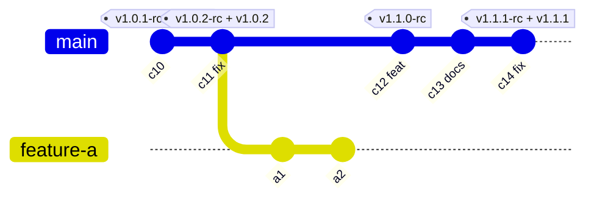
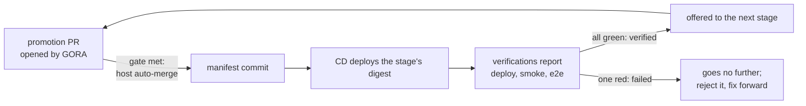
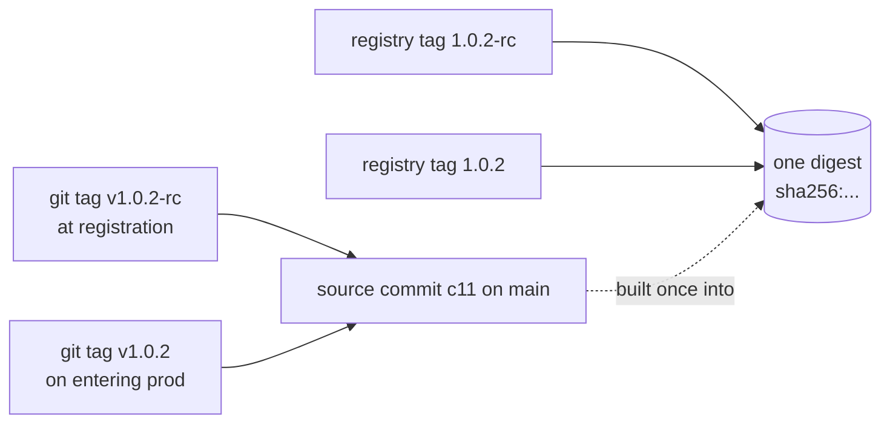
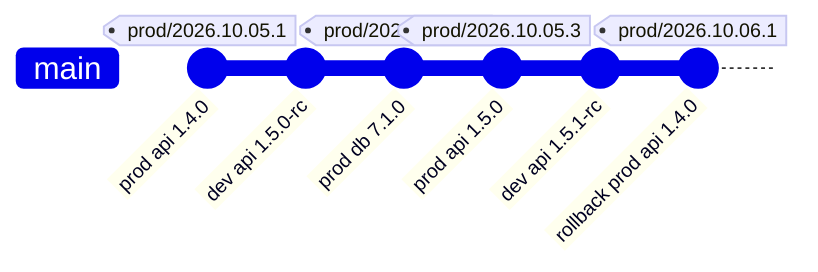
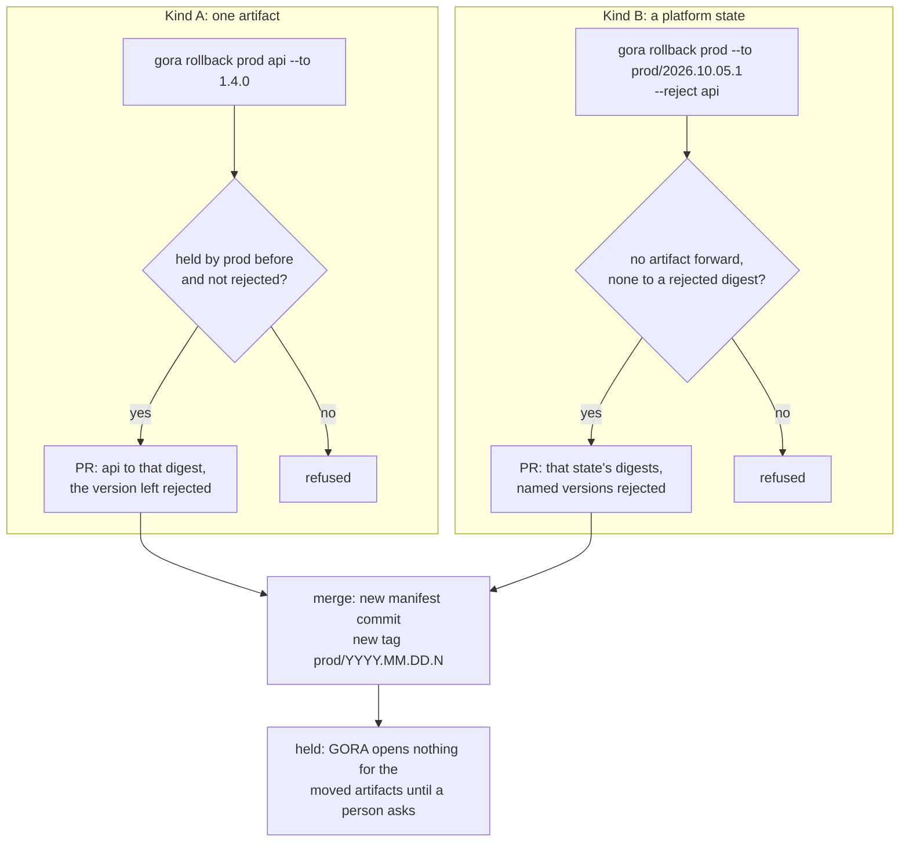

# Release model

This is the map of how an artifact travels from a merge on `main` to production, and of the laws
that hold on the way. The decisions behind it are Architecture Decision Records:
[ADR-022](../adr/0022-lifecycle-on-trunk.md) decides the lifecycle on trunk;
[ADR-023](../adr/0023-command-model-and-stage-loop.md) the stage loop and the commands;
[ADR-024](../adr/0024-versions-and-promotion.md) the versions and the order of promotion;
[ADR-025](../adr/0025-dependencies-and-migrations.md) that artifacts have no dependencies;
[ADR-026](../adr/0026-release-repository.md) the files of the release repository, who writes
them and their schema. If this map and an ADR disagree, the ADR is right and the map has a
defect.

**The rule for every change.** A change, a recommendation or a plan that contradicts a law
below stops there: it is raised with the maintainer, never worked around and never
reinterpreted. A law changes only through an ADR.

## 1. Vocabulary

GORA's verb is **promote**. In this model an artifact is promoted or it stays where it is; "release"
is not an event and not a verb. The word survives only in names already fixed: the product, the
files `release-policy.yaml` and `release-manifest.yaml` (retired by ADR-026), the `release.yml`
workflow, and nouns the ADRs use (release repository, release files, release state, Release BOM,
release record).

| Term | Meaning |
| --- | --- |
| Project | One release repository: one policy, one manifest, one system whose artifacts are promoted through the same stages and roll back together. The same for one artifact or a hundred; the artifacts may be built in any number of code repositories. A separate system is a separate project. |
| Artifact | One deployable unit, identified by an OCI digest (for GORA itself, an image index). Written in any language: GORA sees the digest and its evidence, never the build. |
| Release files | What a release repository holds for GORA: `release-policy.yaml` and each artifact's declaration `artifacts/<artifact>/artifact.yaml`, which people write; the `state/` and `rejections/` trees, which only GORA writes; `.github/CODEOWNERS`. Nothing else. |
| Manifest | The `state/` tree: one file per artifact and stage, `state/<stage>/<artifact>.yaml`, with the digest the stage holds, its version and the pointer to its evidence. A manifest commit is a commit on `main` that changes it. |
| Owners | The code owners `.github/CODEOWNERS` names: the release owners own the policy and that file, a team owns its artifacts' declarations. Every change of policy is its owners' decision (L25). |
| Inputs | The paths whose change changes an artifact, declared in its declaration as path globs. Release files are never inputs. |
| Candidate | A commit on `main` whose artifact inputs differ from those of the artifact's newest registered candidate, built once by the project's CI, verified and registered by GORA. |
| Registration | GORA's step that turns a verified build into a candidate: it computes the version and creates the tags. |
| rc version | `X.Y.Z-rc`, a candidate's version in every stage before `prod`. Each candidate has its own. |
| Final version | `X.Y.Z`, the same digest once it has entered `prod`. |
| Stage | An environment of the promotion graph, declared in policy as an ordered list whose last stage is `prod` (`dev`, `qa`, `staging`, `prod` in the examples). |
| Promotion | A pull request, opened by GORA, that moves a digest into a stage. Never a build. |
| Gate | What a promotion PR needs before the code host's auto-merge merges it: `auto`, the other required checks; `approval`, those and the reviews of the groups the policy names. Nobody merges by hand. |
| Verification | A check of a stage after its deployment (`deploy`, `smoke`, `e2e`), reported by the CD or a test system as the commit status `<stage>/<artifact>/<name>` from the reporter the policy names. |
| Verified | A version is verified in a stage when, in the stage's latest holding of it, the newest status of every verification of that stage, for that artifact, is green from its reporter. It stays verified after the stage moves on. |
| Offered | A version is offered to a stage when it is not rejected, newer than the version the stage holds, not passed over there before, and verified in the stage before (for the first stage, registered). |
| Eligible | An offered version whose evidence passes: it may enter the stage. |
| Reject | A recorded decision of a person whom policy allows, that a version is bad (both names of its digest, rc and final): it never moves forward and is never a rollback target. |
| Rollback | A forward promotion to a digest the stage held before, asked for by a person whom policy allows, in an emergency. Kind A: one artifact, whose version left is rejected. Kind B: a whole platform state, rejecting the versions of the artifacts the request names. |
| Held | The state of an artifact in a stage after a rollback: GORA opens nothing for it there until a person asks. |
| Platform state | A manifest commit that changed what `prod` holds, tagged `prod/YYYY.MM.DD.N`. |
| Law | An invariant in GORA's code. The same for every project; not configurable. |
| Policy | A project's declaration inside the laws, in `release-policy.yaml` (stages, gates and their approvers, verifications and their reporters, builders, who may ask for what) and the artifacts' declarations (each artifact, its inputs and builders, and the approvers and verifications it adds). |
| Retire | To remove an artifact or a stage: people remove it from the policy, then a GORA PR deletes its state files. Its name is never used again. |

## 2. The lifecycle

```mermaid
flowchart LR
  PR["pull request<br/>branch from main"] -->|"squash, tested as it lands"| M["commit on main"]
  M -->|"inputs changed"| B["project CI builds once<br/>digest + provenance"]
  B --> V["GORA verifies the evidence"]
  V -->|"tag vX.Y.Z-rc<br/>on the source commit"| C(["candidate"])
  C -->|"gate: auto"| DEV["dev"]
  DEV -->|"gate: approval"| QA["qa"]
  QA -->|"gate: approval"| STG["staging"]
  STG ==>|"gate: approval<br/>final version X.Y.Z, same digest"| PROD["prod"]
  PROD -.->|"tag prod/YYYY.MM.DD.N"| S[("platform state")]
```



1. A developer branches from `main` and works on a short-lived branch, a feature, a fix or a
   hotfix alike. Its CI builds and tests, but nothing it builds is registered, tagged or
   promoted (L5).
2. The pull request is squash-merged; `main` receives exactly the tree that was tested (L2,
   L3). One pull request is one commit on `main`, and its title is a Conventional Commit (L11).
3. If the commit changed an artifact's inputs (L8), the project's CI builds that artifact once
   and hands GORA the digest with its provenance (L7, L9).
4. GORA verifies the evidence (ADR-018), computes the version from the previous candidate's
   (L11) and tags the source commit `vX.Y.Z-rc` (L10). The candidate exists.
5. The stage loop opens the promotion PR into the first stage once the version that stage holds
   has finished its verifications. `dev` is `gate: auto`: the code host merges the PR once the
   required checks pass (L15).
6. Each next stage takes an eligible version, one that the stage before has verified, through a
   promotion PR that GORA opens itself and the code host merges when its gate is met (L12, L14,
   L15, L24). Nothing waits for a newer candidate (L13).
7. The promotion into `prod` records the final version `X.Y.Z` of the same digest. When it is
   merged, GORA tags the same source commit `vX.Y.Z` and adds the registry tag `X.Y.Z` to the
   same digest (L10, L13).
8. That merge changes `state/prod/`, what `prod` holds: it is a platform state, tagged
   `prod/YYYY.MM.DD.N` on that commit (L17).
9. The CD system applies what the manifest says (ADR-019 section 6) and reports the result;
   the stage's verifications report theirs. GORA never deploys and never tests.

## 3. Branches and candidates



- `main` is the only long-lived branch (L1). Every branch starts from `main` and ends in one
  squash commit on it (`c12` is `feature-a`), and is deleted when it is merged (L6); `a1` and
  `a2` never become artifacts (L5). No branch starts from a version tag.
- `c13` changed no input of the artifact, so it is not a candidate (L8).
- Every version tag sits on the source commit its digest was built from: `v1.0.2-rc` and the
  final `v1.0.2` share `c11` (L10).
- `1.1.0-rc` was rejected in a stage and never entered `prod`, so `v1.1.0` does not exist. The
  fix is `c14`, a new commit on top of `main`, promoted through every stage. It carries `c12`'s
  feature with it, so an unfinished feature stays behind a flag: `main` is always promotable
  (L4).
- A hotfix is the same: an ordinary pull request to `main`, promoted through the same stages
  (L19).

## 4. Stages, gates and the order of promotion

The stages, their gates and their approvers are policy; the mechanism is the same for every project.
An artifact's declaration may add approvers and verifications to a stage for that artifact, never
remove them (ADR-026 section 5). A pipeline with no person in it has every gate `auto`; one with a
QA team has a `qa` stage whose approvals are QA's:

```text
dev (auto) → qa (approval: team/qa) → staging (approval: team/qa)
    → prod (approval: release-owners)
```

QA approves the promotion into `qa` when it takes a version into testing, and the promotion into
`staging` when it has tested it. Every stage before `prod` holds the rc version; `prod` holds the
final version. The digest never changes on the way (L12).

**The stage loop.** A merged promotion changes only the manifest; this loop moves the artifact
on, the same for every stage (ADR-023 section 8, ADR-024 section 4):



- **Offered and eligible.** A version is offered to a stage when it is not rejected, it is newer
  than the version the stage holds, the stage has not passed it over before, and the stage
  before has verified it. It is eligible when, in addition, its evidence passes; a check that
  cannot complete is not a failure, and the run opens and closes nothing for it.
- **One at a time.** The loop opens a promotion into a stage only when the version the stage
  holds has finished its verifications: one red, or all green. A failed version does not block
  the stage; it goes no further. The loop never replaces an open PR; GORA closes one whose
  version is no longer eligible, and the loop proposes again.
- **An `approval` stage is offered every version the stage before verified, in order.** The
  loop proposes the oldest offered version, so QA is offered `1.0.2-rc` while `dev` already
  holds `1.1.0-rc`, and, if both pass, `prod` receives `1.0.2` and then `1.1.0`. GORA never
  skips a version there: while the oldest offered version is not eligible, the stage is blocked
  and shows why, until a person rejects that version or asks for a newer one.
- **An `auto` stage takes the newest eligible version.** Nobody is offered anything there, and a
  version it passes over is contained in the newer one; taking the oldest would let it fall behind
  `main` without limit.
- **A person may ask for any eligible version**, in any stage:
  `gora promote STAGE [ARTIFACT] --version VERSION`. The versions it passes over never enter that
  stage. Closing a PR is not a skip: in an `approval` stage the version waits for a person; in an
  `auto` stage the loop moves on when a newer version is eligible.
- **Nothing waits for a newer candidate.** A version moves when it is eligible, its turn has come
  and its gate is met, whatever has been registered since (L13, L20).
- **Gate.** `auto`: the other required checks pass. `approval`: they pass and the groups the
  policy names have approved the PR. GORA's required status turns green, and the code host's
  auto-merge, enabled when GORA opened the PR, merges it. GORA's status stays green only while
  the version is eligible. Approvals are reviews, never labels.
- **An approval binds to the promotion.** GORA recomputes its branch whenever `main` moves; an
  approval given on GORA's commit for that promotion stays while the branch carries exactly
  that promotion. A commit anyone else pushes to it turns GORA's status red. Only GORA's
  identity can set GORA's status.
- **Verifications.** The policy lists at least one per stage for every artifact. The CD and the test
  systems run them and report each as the commit status `<stage>/<artifact>/<name>` on the manifest
  commit that set the artifact's entry in the stage, or on a later commit where that entry is
  unchanged; GORA counts a status only from the reporter the policy names. Argo CD reports `deploy`
  through its notifications controller, like any reporter.
- **Only forward.** A stage never takes a version older than the one it holds. Moving a stage
  back is a rollback, which a person asks for and which rejects (section 7).
- **No artifact stalls unseen (L24).** Every artifact in every stage is in exactly one state, the
  first that applies, shown by `gora status` with the time spent in it: retiring (its declaration
  or the stage has been removed, and GORA opens nothing for it but the PR that deletes its file);
  at the gate (one open
  promotion or rollback PR); held after a rollback; verifying; blocked, with the reason (the version
  the stage's order proposes cannot get a PR: a person closed it, a rejection is open, or its
  evidence fails; in an `auto` stage, also when no offered version is eligible); ready (GORA has not
  opened the PR yet); waiting for a newer version the stage before holds and is still verifying; in
  sync (nothing is offered; a newer version the stage before holds failed or was rejected there, or
  was passed over here, and `gora status` says which). It also shows whether the version the stage
  holds is verified, failed or rejected, and how many offered versions wait.
- **When it runs.** On every event (a registration, a merge, a status, a review) and as a
  periodic reconciliation, so a missed event delays the loop but never strands an artifact. The
  re-check never holds back or batches a version, so it is not a schedule (L20). Each run
  computes from Git and the code host alone and keeps no state of its own.

One artifact, two developers, step by step (the history of section 3):

| Step | Event | dev | qa | staging | prod |
| --- | --- | --- | --- | --- | --- |
| 1 | Start | 1.0.1-rc | 1.0.1-rc | 1.0.1-rc | 1.0.1 |
| 2 | `c11` (`fix`) registered as `1.0.2-rc`; dev is `auto` | 1.0.2-rc | 1.0.1-rc | 1.0.1-rc | 1.0.1 |
| 3 | `c12` (`feat`) registered as `1.1.0-rc`; `1.0.2-rc` verified in dev, so dev takes `1.1.0-rc` and GORA proposes `1.0.2-rc` to qa | 1.1.0-rc | 1.0.1-rc | 1.0.1-rc | 1.0.1 |
| 4 | QA approves `1.0.2-rc` into qa and tests it; `1.1.0-rc` is verified in dev and waits its turn | 1.1.0-rc | 1.0.2-rc | 1.0.1-rc | 1.0.1 |
| 5 | QA approves `1.0.2-rc` into staging; smoke is green | 1.1.0-rc | 1.0.2-rc | 1.0.2-rc | 1.0.1 |
| 6 | Release owners approve `1.0.2` into prod: tags `v1.0.2` and `prod/2026.10.08.1` | 1.1.0-rc | 1.0.2-rc | 1.0.2-rc | 1.0.2 |
| 7 | QA approves `1.1.0-rc` into qa, finds a defect and rejects it | 1.1.0-rc | 1.1.0-rc | 1.0.2-rc | 1.0.2 |
| 8 | `c13` (`docs`) changes no input: no candidate | 1.1.0-rc | 1.1.0-rc | 1.0.2-rc | 1.0.2 |
| 9 | `c14` (`fix`) registered as `1.1.1-rc`; it passes dev, qa and staging | 1.1.1-rc | 1.1.1-rc | 1.1.1-rc | 1.0.2 |
| 10 | Release owners approve `1.1.1` into prod: tags `v1.1.1` and `prod/2026.10.09.1` | 1.1.1-rc | 1.1.1-rc | 1.1.1-rc | 1.1.1 |

## 5. Versions

Two kinds of version, in separate namespaces, never compared with each other:

| Namespace | Example | Points at | Answers |
| --- | --- | --- | --- |
| Artifact version, git tag | `v1.0.2-rc`, `v1.0.2`; `api/v1.0.2` for an artifact declared after the first of its code repository | the source commit | what changed in the artifact (SemVer: a compatibility promise) |
| Artifact version, registry tag | `1.0.2-rc`, `1.0.2` | the digest | the same, for whoever pulls the image |
| Platform state | `prod/2026.10.05.2` | the manifest commit | what `prod` held, and since when (CalVer: no promise) |

How GORA computes an artifact version (L11):

- **From the previous candidate.** Over the first-parent commits after the artifact's previous
  registered candidate, up to and including this one, that changed the artifact's inputs, take
  the highest bump: a breaking change (`!` after the type or scope, or a `BREAKING CHANGE:` or
  `BREAKING-CHANGE:` footer) is major, and minor while the major version is `0`; `feat` is
  minor; anything else is patch, a revert included unless its own message says more. A change
  to inputs is at least a patch.
- **The first candidate** takes the artifact's initial version, declared in its declaration (a
  connect condition, section 9). The major version leaves `0` once, by `stable: true` in the
  declaration: the next candidate is at least `1.0.0-rc`.
- **Tag prefix.** The first artifact ever declared for a code repository tags `vX.Y.Z` and keeps
  it when a second is declared; every later one prefixes its name, `api/vX.Y.Z`. Adding an
  artifact never changes another's tags (ADR-026 section 5).
- **Source.** GORA reads the commit message on `main`: the pull request title is its subject and
  the pull request body its body (repository settings, section 9). A subject that is not a
  Conventional Commit counts as a patch and is reported.
- **Never reused.** A rejected candidate, or one that never reaches `prod`, keeps its number; the
  next candidate is computed after it. `prod` may go from `1.0.2` to `1.1.1`: the number grew by
  at least the largest change it carries, which is the promise SemVer makes.
- **Order.** SemVer 2.0 precedence follows the history of `main`:
  `1.0.2-rc < 1.0.2 < 1.1.0-rc < 1.1.1-rc < 1.1.1`.
- **No build metadata, nothing inside the artifact.** A version is SemVer without `+…`
  (ADR-003). The artifact does not carry its version (jar manifest, assembly version,
  `package.json`); it carries its source commit as `org.opencontainers.image.revision` (L9),
  because one digest is first `X.Y.Z-rc` and then `X.Y.Z`. An application that shows its
  version reads it from its environment at deploy time.



## 6. Platform states

The manifest, the `state/` tree, says which digest each stage holds, one file per artifact and
stage. It changes only through a GORA PR (L16), so every state of a stage is one commit on
`main`. A commit that adds, deletes or changes the content of an entry under `state/prod/`, the
last stage, is tagged `prod/YYYY.MM.DD.N` (L17); a platform state is the `state/prod/` tree at
that commit. With artifacts promoted on their
own, a platform of twenty services has several states a day, each a full picture of every
digest `prod` held at that moment.

- **Computed from history, not counted.** `YYYY.MM.DD` is the UTC committer date of the
  manifest commit; `N` is its position among that day's commits that changed what `prod` holds,
  in first-parent order. Running the computation again gives the same tag. A promotion every day
  of a month gives `prod/2026.10.01.1` to `prod/2026.10.31.1`; five in one day give `.1` to
  `.5`. There is no limit.
- **Ordered as numbers.** GORA orders states by the date, then by `N` as a number: `.10`
  follows `.9`.
- **A label of a state, not a promise.** CalVer has no major or minor; it says when, which is
  what audit and rollback need. Compatibility is the artifacts' SemVer.
- **Each artifact moves on its own.** A promotion PR moves one artifact; GORA has no
  dependencies between artifacts (L21). Whether versions of different artifacts work together,
  and in what order they reach a stage, is the project's.

The manifest's commits on `main`, each a merged promotion PR:



`db 7.1.0` and `api 1.5.0` are two artifacts, each promoted on its own; the order is the
project's. The rollback in the last commit returns `api` alone; `api 1.4.0` runs on the schema
that `db 7.1.0` left because the project expands before it contracts (section 8).

## 7. Rollback

A rollback is a promotion forward to a digest the stage held before and that is not rejected.
It opens a promotion PR, creates a new manifest commit and, for `prod`, a new state tag. History
is never rewritten (L18).



- The commands in the diagram are those of ADR-023 section 2 (section 11 here).
- A rollback is an emergency, asked for with a reason by a person whom policy allows for that
  stage. The request is the decision: the rollback PR merges once the other required checks
  pass (ADR-023 section 10).
- Kind A returns one artifact, when the culprit is known. Kind B returns every artifact of
  `prod` to a named platform state in one PR, when several promotions came after the last good
  state, or as a recovery point.
- A rollback rejects. Kind A rejects the version it leaves. Kind B rejects, for each artifact
  the request names (at least one), the version the stage held before the rollback; a named
  artifact the rollback does not move is refused. A rejected version never comes back: the way
  on is a fix, a new candidate and every stage.
- **A rollback holds the stage.** Afterwards GORA opens no promotion into that stage for the
  artifacts the rollback moved until a person asks with `gora promote`; then the stage moves
  forward as usual (ADR-024 section 6). An artifact that had nothing to do with the incident is
  brought back that way, as soon as the incident allows; automation never undoes a rollback, and
  a version the stage passed over before never enters it.
- GORA computes the target and opens a PR; it never `git revert`s a manifest commit, which can
  hold the promotions of other artifacts made since (ADR-022 section 10).
- Kind B moves every artifact whose version in the named state differs from the one `prod`
  holds, a migration like any other; it is refused if that would move one to a newer version or
  to a rejected digest. An artifact the state does not contain, or one retiring or retired since,
  keeps its version.
- A rollback returns a stage to what it held before; it does not restore data. What an older
  version does when it runs again, including a migration's, is the project's (section 8).

## 8. Migrations

A database migration is an artifact like any other (L21): an image of the project's migration
tool (Flyway, Liquibase, Alembic, goose, an EF Core bundle), its own inputs (`db/**`), its own
SemVer versions, the same stages, the same loop and the same rollbacks. GORA promotes it; the
CD system runs it (a Kubernetes Job, an Argo CD PreSync hook, a pipeline step).

- **GORA has no rules of its own for migrations**, and no dependencies between artifacts: a
  migration and the services that use its database are separate artifacts, each promoted on
  its own (ADR-025).
- **The project owns compatibility.** Forward only, expand before contract, a schema that works
  with the service version before it, and the order in which a migration and a service reach a
  stage are the project's discipline, held by its CI and review, and by the people who approve
  at an `approval` gate. GORA does not read what a migration does.

## 9. What a project meets to connect

GORA sets the conditions; a project that does not meet them is not connected (ADR-019
section 3, L23).

- `main` protected: pull requests only, squash only, linear history, no force-push, no deletion.
- Every commit tested as it lands: required checks in strict (up-to-date) mode, or a merge
  queue where the host offers one, which adds throughput. GORA reads which from the host's rules
  and works in either mode (ADR-023 section 12).
- Required checks include GORA's status, posted on every pull request to `main` (success when
  nothing is promoted), and a Conventional Commits check of the PR title that accepts any type,
  since GORA's own titles are `promote`, `rollback`, `reject`, `retire` and `migrate` (ADR-024
  section 8, ADR-026 section 8).
- A squash commit takes the PR title as its subject and the PR body as its body.
- The repository deletes head branches after merge, and allows auto-merge.
- Tag rules: version tags and state tags cannot be updated or deleted, and only GORA's machine
  identity creates them.
- GORA's own machine identity on the code host, with its minimal permissions (on GitHub, its
  GitHub App); its secret only where GORA's writes run: the release repository's pipeline,
  reachable only by the pipeline definition on `main` (on GitHub Actions, an environment whose
  deployment branches are `main` only), or GORA's server.
- GORA's required status bound to GORA's identity as its only source (on GitHub, the required
  check's expected source app).
- Only GORA's identity creates, updates or deletes `gora/*` branches (on GitHub, a branch
  ruleset on `gora/**` with GORA's App as its only bypass actor). GORA deletes its own merged
  branches itself (L6).
- The approver groups and the groups who may ask exist on the code host as its teams (a short
  list may name host accounts; an email address is never an identity). The host's own
  required-review rules do not block GORA's PRs: `main` requires no host review, or GORA's
  identity is exempt from that rule alone.
- The CD and test systems report each verification as a commit status, from the identity the
  policy names for it; Argo CD reports `deploy` through its notifications controller.
- CI builds a candidate only from `main`, once, and hands over a digest with provenance; the
  image carries its source commit, not its version.
- Every artifact declared in `artifacts/<artifact>/artifact.yaml` with its inputs, migrations
  included; an artifact's initial version, as `X.Y.Z-rc`, orders after every version tag of it
  that exists.
- `.github/CODEOWNERS` the only code-owner file, its patterns anchored: the release owners own
  `/release-policy.yaml` and `/.github/CODEOWNERS`, every directory under `artifacts/` has an
  owner, and `/state/` and `/rejections/` come last with no owner (ADR-026 section 13).
- The last stage of the promotion graph is named `prod`.
- `main` always promotable: unfinished work behind flags.

A host or a plan that lacks one of these (protected branches with required checks, a required
status only GORA's identity can set, reviews that name their commit, protected tags) does not
connect; `gora connect check` names what is missing.

## 10. Laws

Status: "in force", a mechanism refuses a violation today; "by design", GORA has no operation
that could break it; "contract", the project commits to it when it connects; "follows", it is a
consequence of other laws; "planned", the law is decided and binding, and until its mechanism
exists the operator and the review hold it.

| # | Law | Enforced by | Decided in | Now |
| --- | --- | --- | --- | --- |
| L1 | One trunk. `main` is the only long-lived branch: no release, hotfix or develop branches, no cherry-picks. | GORA registers candidates only from `main` | ADR-022 §1 | planned |
| L2 | Nothing is pushed to `main`. Every change is a pull request, squash-merged; history linear; no force-push, no deletion. | ruleset `protect-main` | ADR-019 §2, ADR-022 §2 | in force |
| L3 | `main` never receives an untested combination: every commit is tested as the exact tree it lands as. | required checks in strict mode; a merge queue where the host offers one | ADR-022 §2, ADR-023 §12 | in force |
| L4 | `main` is always promotable: unfinished work is behind flags; a red `main` is fixed forward. | connect contract; review | ADR-022 §1, §4 | contract |
| L5 | A feature branch produces no artifact: nothing built from it is registered, tagged or promoted, or pushed where candidates come from. | GORA refuses a digest whose provenance names a ref other than `main` | ADR-022 §4 | planned |
| L6 | A merged branch is deleted. GORA deletes its own `gora/*` branches; unmerged branches past the policy's age are reported, never deleted. | repository setting (connect check); GORA | ADR-022 §13 | planned |
| L7 | GORA never builds. The project's CI builds each candidate once and hands over a digest with provenance. | GORA has no build operation; evidence check (ADR-018) | ADR-001, ADR-022 §3 | by design; evidence check planned |
| L8 | A candidate is a commit on `main` whose declared inputs differ from those of the artifact's newest registered candidate. Release files are never inputs. | policy validation; GORA | ADR-022 §4 | planned |
| L9 | An artifact does not carry its version; it carries its source commit (`org.opencontainers.image.revision`). | GORA refuses a digest whose revision is not the source commit | ADR-022 §3 | GORA's own image in force (CI `assemble` refuses an index without its revision); refusal of a digest planned |
| L10 | Only GORA creates version tags: `vX.Y.Z-rc` on the source commit when it registers a candidate, in the first-parent order of `main`, never on an older commit after a newer one; and `vX.Y.Z` on the same source commit when that version first enters `prod`. A tag never moves. | tag ruleset `protect-release-tags` (no update, no deletion, creation only by GORA's machine identity); GORA | ADR-018 §7, ADR-022 §6, ADR-024 §2, §10 | no update or deletion in force; creation by GORA's identity planned |
| L11 | GORA computes each candidate's version from the previous registered candidate's and the Conventional Commits since it; a change to inputs is at least a patch; a version is never reused. | required PR-title check; GORA | ADR-022 §5, ADR-024 §1 | PR-title check required in `protect-main` (in force); computation planned |
| L12 | Promotion moves a digest that is not rejected and that the stage before held and verified (into the first stage, a registered candidate). Nothing is rebuilt; the final version is the rc version without `-rc`, on the same digest. | GORA | ADR-004, ADR-018 §4, ADR-022 §7, ADR-024 §3 | same digest across stages in force (`promote`); eligibility and final retag planned |
| L13 | A version becomes final only by entering `prod` through its gate. No eligible version waits for a newer one. | GORA | ADR-024 §2, §4 | planned |
| L14 | At most one open GORA pull request per artifact and stage; a kind B rollback counts for every artifact it moves. The loop opens none while one is open; a person's request replaces an open promotion; while a rollback pull request is open, any other promotion or rollback of its artifacts into its stage is refused. A retirement counts as the open pull request of every pair whose file it deletes; a migration counts for none. | GORA; one branch per key | ADR-022 §7, ADR-023 §6, ADR-024 §4, ADR-026 §8 | planned |
| L15 | GORA never merges by its own decision, and nobody merges its PRs by hand. The code host's auto-merge merges a GORA PR once its gate is met: `auto`, the other required checks; `approval`, those and the reviews the policy names; a rollback, a rejection or a migration, those and the request of a person whom policy allows; a retirement of an artifact or a stage, those, once people have decided it. | GORA's adapter has no merge operation | ADR-013, ADR-022 §7, ADR-023 §8, §10, ADR-026 §8 | no merge operation in force; gates and "nobody by hand" planned (section 13) |
| L16 | The state (`state/`) and the rejections (`rejections/`) change only through a GORA pull request: a promotion, a rollback, a rejection, a retirement of an artifact or a stage, or a migration that changes no content. A rejection's content never changes and it is never removed. | required check refusing a change to those paths from outside `gora/*`, and a migration that changes a `spec` | ADR-019 §2, ADR-022 §9, ADR-026 §1, §8 | planned |
| L17 | Every change to what `prod` holds is one commit on `main` that adds, deletes or changes the content of an entry under `state/prod/`, tagged `prod/YYYY.MM.DD.N`. A state tag never moves. | GORA; tag ruleset `protect-state-tags` | ADR-022 §9, ADR-026 §8 | no update or deletion of state tags in force; tagging planned |
| L18 | A rollback is a forward promotion to a digest the stage held before and that is not rejected: one artifact (A) or a platform state (B). It rejects the version it leaves (A) or the versions the request names (B). History is never rewritten. | GORA refuses any other target | ADR-018 §4, ADR-022 §10, ADR-023 §10, ADR-024 §6, ADR-025 §3 | planned |
| L19 | A hotfix is an ordinary pull request to `main`, promoted through the same stages. | follows from L1 and L12 | ADR-022 §1 | follows |
| L20 | No release train: no schedules, windows, freezes or batches. A version moves when it is eligible, its turn in the stage has come and its gate is met. | GORA has no such feature; the policy schema refuses such fields | ADR-022 §12, ADR-024 §10 | by design; schema planned |
| L21 | GORA has no dependencies between artifacts and no kinds of artifact: a migration is an artifact like any other. Whether versions work together, and in what order they reach a stage, is the project's. | GORA has no such feature; the policy schema has no field for it | ADR-022 §11, ADR-025 §1, §4 | by design; schema planned |
| L22 | GORA acts on a code host only as its own machine identity there (on GitHub, its GitHub App): never a person's token, the narrowest scope the host allows, a credential that expires, the secret only where GORA's writes run (the release repository's pipeline, from `main` only, or GORA's server). | connect check; a write refuses without that identity | ADR-022 §14, ADR-023 §7, §11 | planned |
| L23 | Policy cannot switch a law off; a change of policy that would break one is refused by GORA's required status, and a project whose policy breaks one is not connected. | policy schema validation; GORA's required status | ADR-022 §15, ADR-026 §13 | planned |
| L24 | No artifact stalls unseen: every artifact in every stage is in exactly one state, the first that applies. GORA opens each next promotion itself: into an `approval` stage the oldest offered version once it is eligible, into an `auto` stage the newest eligible version; a person may ask for any eligible version. After a rollback GORA opens nothing for the artifacts it moved until a person asks. | GORA's stage loop, on events and as a periodic reconciliation; `gora status` | ADR-023 §8, §9, ADR-024 §4, §6, §10, ADR-026 §14 | planned |
| L25 | Every change to policy is its owners' decision. A pull request that changes the policy, the code-owner file or a declaration is decided, path by path, by the owners the base branch names (the release owners for a path with none): an owner reviewed exactly that change, approving it or, as the one who opened it, with an `/approve` review, and no owner asks for changes. | GORA's required status | ADR-026 §13 | planned |

## 11. Commands

One grammar for the CLI, the HTTP API and Slack (ADR-023). Commands that write are named by
their verb; commands that read, by what they show. `-p` selects the project, a release
repository; the artifact is named unless the project has only one.

| Command | Does | API (under `/v1/projects/{p}/` unless absolute) |
| --- | --- | --- |
| `gora status [STAGE] [--artifact PATTERN]` | what each stage holds and its L24 state; `--artifact` filters by a glob on the name, a view and not a group | `GET stages[/{s}]` |
| `gora history STAGE` | the manifest commits that changed the stage; for `prod`, its platform states | `GET stages/{s}/states` |
| `gora digest STAGE [ARTIFACT]` | the digest a stage holds, for deploy-on-merge | `GET stages/{s}/artifacts/{a}` |
| `gora changes [--source REPOSITORY] [COMMIT]` | which artifacts' inputs changed at a commit, for the pipeline that builds them | `GET changes` |
| `gora register ARTIFACT --digest D` | CI hands over a build: verify, version, rc tag | `POST artifacts/{a}/candidates` |
| `gora promote STAGE [ARTIFACT] [--version VERSION]` | ask for a promotion: the next one the loop would open, or, with `--version`, a skip forward to that eligible version; it also lifts the hold after a rollback | `POST stages/{s}/promotions` |
| `gora reject ARTIFACT VERSION --reason R` | record a rejection | `POST artifacts/{a}/versions/{v}:reject` |
| `gora rollback STAGE ARTIFACT --to VERSION --reason R` | rollback kind A; rejects the version left | `POST stages/{s}:rollback` |
| `gora rollback prod --to STATE --reject A[,A…] --reason R` | rollback kind B; rejects the named versions | `POST stages/{s}:rollback` |
| `gora migrate [--print [--to VERSION]]` | rewrite GORA's files in the policy's schema version through a PR; `--print` writes people's files converted to standard output | `POST state:migrate` |
| `gora branches` | unmerged branches past the policy's age | `GET branches` |
| `gora connect check` | the conditions of section 9 | `GET conditions` |
| `gora connections` | adapter health | `GET connections` |
| `gora version` | revision and version | `GET /v1/version` |

- No `approve`, `merge` or `signoff` command: an approval is a review on the code host (L15).
- A write runs only with GORA's machine identity (L22); elsewhere only `--dry-run`, which
  prints the plan. Every write is idempotent; `--output json` prints the API's body; a refusal
  names the law.
- `/gora` in Slack takes the same words: `/gora -p cally status prod`.
- GORA's PR titles are Conventional Commits (ADR-024 section 8), and its promotion and rollback
  PRs end with a Git trailer, one line per artifact (ADR-023 section 6):
  `Gora-promotion: <stage> <artifact> <version> <digest>`.
- GORA writes no personal data into Git; who asked and who approved stay in the host's records
  and the audit journal (ADR-017).

## 12. Outside the model

- Release branches, cherry-picks and backports.
- Two major lines in production at once (for example `v10` and `v11`, each maintained). Not
  in GORA's core; it would need its own ADR.
- A promotion graph with branches: the stages are an ordered list (ADR-022 section 7).
- Release trains, freezes, windows and schedules.
- Building and deploying: CI builds, CD deploys (ADR-001, ADR-019).
- Feature flags and application-level rollback: the application's concern (ADR-004).
- Dependencies between artifacts and their compatibility, including a migration's: the
  project's (ADR-025).
- A library published to a package registry (Maven, npm, NuGet, PyPI) is not a deployable
  artifact: it reaches production inside one.

## 13. Where GORA is today

The model is decided; the implementation follows ADR-018, ADR-023 and ADR-024. What is not
built yet, and how the gap is held until it is:

- The operator pushes `v0.2.0-rc.N` tags by hand, lightweight rather than annotated, and the tag
  starts the build (ADR-011). In the model the build runs on `main` and GORA creates the
  annotated tag `vX.Y.Z-rc`. The tags pushed so far are not candidates of the model; GORA's
  policy declares the initial version `0.2.1` (ADR-024 section 9).
- GORA's own manifest is schema v0.1 with the `candidate` block that `cut-rc` writes; it records
  `0.2.0-rc.5` in `dev` and `staging`, while `v0.2.0-rc.6` is built and not recorded. In the
  model candidates live in tags, the registry and their verification attestations.
- `release-policy.yaml` does not exist yet, and GORA's own stages are `dev` and `staging`; its
  stages in the model are `dev`, `staging` and `prod` (ADR-024 section 9).
- The release files of ADR-026 are decided, not built: GORA reads and writes
  `release-manifest.yaml` (schema v0.1) with PyYAML. The pull request that adds GORA's policy,
  its declaration and `.github/CODEOWNERS` deletes it, and the first state file is the first
  promotion of `0.2.1-rc` (ADR-026 section 16). Until GORA's required status checks L25, the
  maintainer's review before merging holds it.
- The CLI still has `cut-rc`, `promote` and `rollback --to-version --to-digest`; the commands of
  section 11 and the stage loop are decided, not built. `promote --open-pr` reads the local
  manifest rather than the base branch (ADR-013), names its branch with the old key
  `gora/promote-<stage>-<version>`, and titles its PR `Promote <version> to <stage>`, which the
  required title check refuses.
- `promote --open-pr` acts with a person's token (`GORA_GITHUB_TOKEN`) until GORA's GitHub App
  exists (L22). `cut-rc` and `rollback` write the local manifest, and the operator opens their
  pull request from an ordinary branch (ADR-019 section 2).
- Until the gates and GORA's required status exist, the maintainer merges GORA's PRs by hand
  after review; GORA itself still has no merge operation (L15).
- This repository holds L3 through required checks in strict mode. A merge queue would add
  throughput only; GitHub offers it to private repositories only on Enterprise Cloud, and GORA
  works in either mode.
